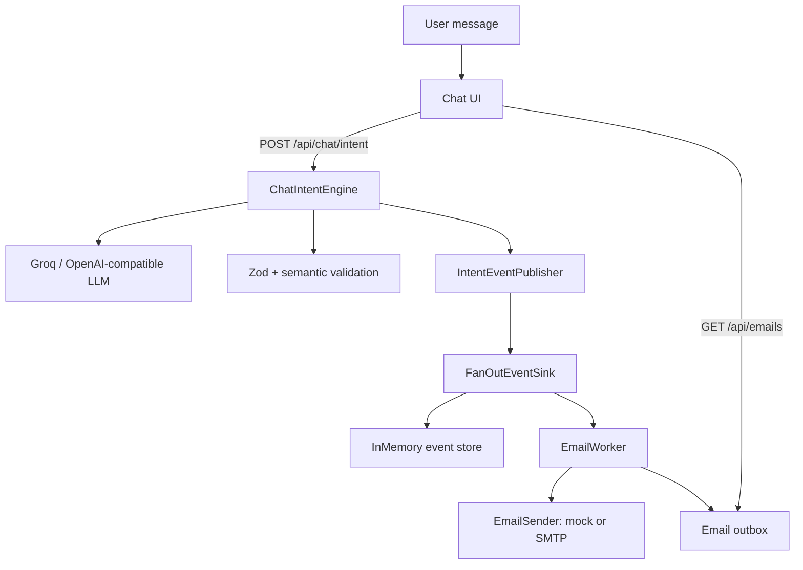
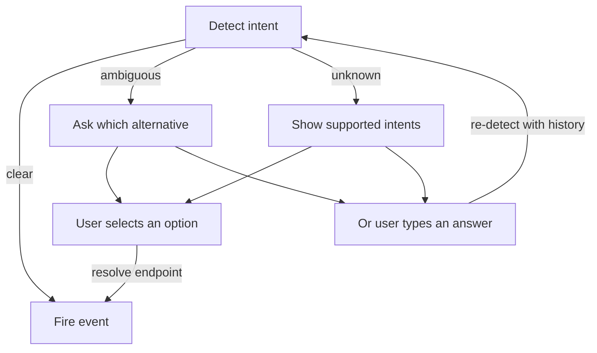

# Intent Understanding Engine + Email Automation

A TypeScript monorepo that turns natural-language chat messages into validated intent events, and (for `send_email`) sends the email through a worker.

The system is intentionally split into two parts:

- a framework-free **intent engine** that only interprets text;
- a **chat application** that asks clarifying questions, fires events, and runs side-effecting workers.

The engine never sends email, calls SAP, or executes workflows itself. Side effects happen only in the worker.

## Documentation

- [Architecture](docs/ARCHITECTURE.md) — components, intent pipeline, events, clarification, email worker.
- [Setup](docs/SETUP.md) — installation, Groq, Gmail SMTP, testing, troubleshooting.

---

## Quick start

```bash
# 1. Install
npm install

# 2. Configure
cp front-end/.env.example front-end/.env
# Add your Groq key and (optionally) Gmail SMTP credentials

# 3. Run
npm run dev
```

Open http://localhost:4321.

Minimum configuration to test intent detection:

```env
GROQ_API_KEY=gsk_...
INTENT_LLM_BASE_URL=https://api.groq.com/openai/v1
INTENT_LLM_MODEL=openai/gpt-oss-20b
INTENT_LLM_MOCK=false
```

Without a key, the app automatically uses a local mock classifier so the UI and event pipeline still work.

---

## Architecture



Key rule: **ambiguous or unknown intents do not fire events.** The UI asks a clarifying question first. Only a `clear` intent reaches the worker.

---

## Repository structure

```text
.
├── package.json                 # npm workspaces + root scripts
├── front-end/                   # Astro 5 + React 19 chat app
│   ├── src/
│   │   ├── components/auth/     # demo login/signup
│   │   ├── components/chat/     # chat transcript, clarification, intent cards
│   │   ├── lib/auth.ts          # localStorage demo auth
│   │   ├── lib/intent.ts        # client for the intent API
│   │   ├── pages/api/chat/intent.ts       # detect + publish
│   │   ├── pages/api/chat/intent/resolve.ts # user-selected intent
│   │   ├── pages/api/emails.ts  # inspect the in-memory email outbox
│   │   └── server/
│   │       ├── env.ts           # process.env / import.meta.env helper
│   │       ├── intent.ts        # shared publisher + fan-out
│   │       ├── mock-intent.ts   # deterministic local classifier
│   │       ├── email-worker.ts  # event-driven email state machine
│   │       └── email-sender.ts  # mock + Gmail SMTP senders
│   └── test/                    # Vitest tests for sender + worker
└── packages/chat-intent-engine/ # framework-free intent engine
    ├── src/core/                # engine, prompts, context, dates, validation
    ├── src/taxonomy/            # closed intent list + registry
    ├── src/events/              # event schema, publisher, sinks
    ├── src/providers/           # OpenAI-compatible provider
    └── test/                    # engine tests
```

---

## Intent engine

### Closed taxonomy

The model may only choose from the supplied list:

`request`, `send_email`, `question`, `informational`, `meeting`, `follow_up`, `complaint`, `approval`, `social`, `notification`, `marketing`, `other`.

Definitions live in `packages/chat-intent-engine/src/taxonomy/definitions.ts`. Each entry has an id, name, description, examples, and synonyms. Adding an intent means adding a definition; the prompt and JSON schema are generated from the registry.

### Input

```ts
{
  message: string;
  history?: { role: 'user' | 'assistant'; content: string }[];
  sessionId?: string;
  messageId?: string;
  timestamp?: string;
}
```

### Result

```ts
{
  intent: {
    primary: string | null;
    status: 'clear' | 'ambiguous' | 'unknown';
    alternatives: string[];
    summary: string;
  };
  entities: { type; text; normalized; evidence }[];
  parameters: { name; value; normalized; evidence }[];
  actionItems: { description; owner; dueDate; evidence }[];
  questions: { question; evidence }[];
  urgency: 'low' | 'normal' | 'high' | 'unknown';
  replyRequired: boolean | null;
  unknowns: string[];
  assumptions: string[];
  ambiguities: string[];
}
```

### Pipeline

1. Validate the input and reject empty messages.
2. Bound the message and history (`maxMessageChars`, `maxHistoryMessages`, `maxHistoryChars`).
3. Build the prompt from the taxonomy, history, and current message.
4. Call the LLM with a strict JSON schema (`response_format: json_schema`).
5. Validate the response with Zod.
6. Check that every intent id exists in the registry.
7. Enforce status consistency:
   - `clear` / `ambiguous` require a primary intent;
   - `unknown` must not have one;
   - `ambiguous` requires at least one alternative.
8. Verify that quoted evidence actually appears in the supplied message/history.
9. Normalize explicit/relative dates when a reference timestamp is available.
10. Return the typed result or a controlled error.

### Provider

`OpenAiCompatibleProvider` uses native `fetch`, so it works with Groq, OpenAI, and similar APIs.

- Groq base URL: `https://api.groq.com/openai/v1`
- Recommended model: `openai/gpt-oss-20b` (strict JSON-schema support)
- Retries on `429` and `5xx`, honoring `Retry-After`
- Configurable `strict` mode for models that only support best-effort schemas

### Events

Event type: `chat.intent.detected`.

The app publishes only `clear` intents (`emitFor: ['clear']`). The event includes the full intent result, including `parameters`.

`FanOutEventSink` forwards each event to:

1. `InMemoryEventSink` (debugging via `GET /api/chat/intent`)
2. `EmailWorker`

---

## Chat application

### Clarification flow

When the result is `ambiguous` or `unknown`, the UI asks a question instead of firing an event:



- Ambiguous options come from `primary + alternatives`.
- Unknown options come from the full taxonomy.
- Max **2 clarification rounds**.
- Selecting an option resolves immediately without another LLM call.
- Free-text answers are re-detected with the original message and clarification question in history.
- No event is fired for `ambiguous`, `unknown`, or unresolved intents.

### Intent card

Each clear intent is shown as a card with:

- intent name and status;
- summary;
- alternatives;
- unknowns;
- event type and id;
- for `send_email`, the send result.

---

## Email automation

### `send_email` parameters

The model is instructed to use these parameter names:

| Name | Meaning |
|---|---|
| `recipient` | explicit email address |
| `subject` | optional subject |
| `body` | message body |
| `cc` | optional CC addresses |

It must not invent an address or body. Missing values go into `unknowns`.

### Worker state machine

`front-end/src/server/email-worker.ts`:

```text
received
  → validating
      → valid   → sending → sent
      → invalid → needs_info
      → sender error → failed
```

Validation rules:

- recipient must be present and match a basic email pattern;
- body must be non-empty;
- subject is optional;
- CC values are split on `,`/`;` and only valid addresses are kept;
- duplicate event ids are processed once.

Results are recorded in `EmailOutbox` and exposed through:

```http
GET /api/emails?sessionId=...
```

### Senders

`front-end/src/server/email-sender.ts` selects the sender from `EMAIL_PROVIDER`:

- `mock` (default): in-memory only, no email delivered.
- `smtp`: real email via nodemailer.

Gmail defaults:

```env
EMAIL_PROVIDER=smtp
EMAIL_FROM=you@gmail.com
SMTP_HOST=smtp.gmail.com
SMTP_PORT=465
SMTP_SECURE=true
SMTP_USER=you@gmail.com
SMTP_PASS=your_google_app_password
```

`SMTP_PASS` must be a Google **App Password**, not the normal account password. App passwords require 2-Step Verification.

---

## API

### `POST /api/chat/intent`

Detects an intent and fires an event if the intent is clear.

```json
{
  "message": "Send an email to john@acme.com saying I'll be late.",
  "history": [],
  "sessionId": "session-1",
  "messageId": "message-1",
  "timestamp": "2026-07-15T09:00:00Z"
}
```

Response includes `result`, `event`, `mock`, `eventCount`, and `supportedIntents`.

### `POST /api/chat/intent/resolve`

Resolves an ambiguous/unknown intent from an explicit user selection. No LLM call.

```json
{
  "result": { "...": "the previous intent result" },
  "intentId": "send_email",
  "sessionId": "session-1",
  "messageId": "message-2"
}
```

### `GET /api/emails?sessionId=...`

Returns the in-memory email outbox for a session:

```json
{
  "count": 1,
  "emails": [
    {
      "to": "john@acme.com",
      "status": "sent",
      "subject": "",
      "body": "I'll be late."
    }
  ]
}
```

### `GET /api/chat/intent`

Debug endpoint returning the in-memory intent events.

---

## Configuration

All values are server-side. Never expose them to the browser.

| Variable | Purpose | Default |
|---|---|---|
| `GROQ_API_KEY` | Groq API key | — |
| `INTENT_LLM_API_KEY` | optional explicit key | falls back to `GROQ_API_KEY` |
| `INTENT_LLM_BASE_URL` | OpenAI-compatible base URL | `https://api.groq.com/openai/v1` |
| `INTENT_LLM_MODEL` | intent model | `openai/gpt-oss-20b` |
| `INTENT_LLM_STRICT_JSON_SCHEMA` | `true` / `false` | `true` |
| `INTENT_LLM_MOCK` | force local mock classifier | `false` |
| `EMAIL_PROVIDER` | `mock` or `smtp` | `mock` |
| `EMAIL_FROM` | sender address | falls back to `SMTP_USER` |
| `SMTP_HOST` | SMTP host | `smtp.gmail.com` |
| `SMTP_PORT` | SMTP port | `465` |
| `SMTP_SECURE` | TLS mode | `true` |
| `SMTP_USER` | SMTP username (Gmail address) | — |
| `SMTP_PASS` | SMTP password / App Password | — |
| `SMTP_URL` | optional full SMTP URL | — |

After changing `.env`, restart the dev server. Vite reads `.env` at startup.

---

## Testing

```bash
npm test          # engine + front-end
npm run typecheck # engine package
npm run build     # Astro server build
```

Current coverage:

- **69 engine tests** — input validation, taxonomy, evidence grounding, date normalization, providers, retries, events, fan-out, publisher dedupe.
- **11 front-end tests** — email worker (valid, missing recipient, invalid recipient, missing body, duplicate event, wrong intent, sender failure) and SMTP/mock sender selection.

The SMTP transport is tested with an injected mail transport, so tests do not send real email.

---

## Troubleshooting

### `Email failed: EMAIL_FROM (or SMTP_USER) must be set`

This occurs when `EMAIL_FROM=` exists but is empty and `SMTP_USER` is set.

The sender currently uses:

```ts
const from = getEnv('EMAIL_FROM') ?? user;
```

`??` does not fall back for an empty string. Workaround:

- set `EMAIL_FROM` to the same Gmail address as `SMTP_USER`; or
- delete the `EMAIL_FROM=` line entirely.

The recommended code fix is:

```ts
const from = getEnv('EMAIL_FROM')?.trim() || user;
```

### `Email needs info: Recipient is not a valid email address`

Use a complete address, e.g. `john@acme.com`, not `john@acme` or `john`.

### `Email needs info: Email body is missing`

Phrase the body explicitly:

> Send an email to john@acme.com saying I’ll be late.

### `Invalid login` / SMTP 535

- Use a Google App Password, not the normal password.
- Enable 2-Step Verification first.
- Keep `SMTP_USER` and `EMAIL_FROM` consistent.
- Remove spaces from the App Password if needed.

### Nothing happens / still mock

- Confirm `INTENT_LLM_MOCK=false`.
- Confirm `GROQ_API_KEY` is set.
- Restart the dev server after changing `.env`.
- Check the `mock` flag in the `/api/chat/intent` response.

### Groq 429

The provider retries `429`/`5xx` with exponential backoff and respects `Retry-After`. Free-tier limits still apply.

---

## Known limitations

- Intent events and the email outbox are **in-memory** and reset on restart.
- Authentication is a **localStorage demo**, not production auth.
- Missing email parameters do **not** trigger slot-filling yet; they produce `needs_info`.
- No contact-directory lookup: “email John” without an address cannot be sent.
- The intent package exports TypeScript source; a compiled consumer should build it.
- Auto-send happens on a clear `send_email` intent, with no confirmation step.
- No queue/webhook sink is wired yet; `IntentEventSink` is the extension point.
- Email subject/body extraction can vary with phrasing. Prefer “saying …” for the body.

---

## Security notes

- API keys and SMTP credentials stay server-side.
- `front-end/.env` is gitignored. Never commit it.
- User text and history are treated as untrusted data; prompt injection is not treated as instructions.
- Events do not include the raw user message.
- The mock sender performs no network calls.
- Gmail App Passwords are safer than account passwords, but still sensitive; rotate them if exposed.
