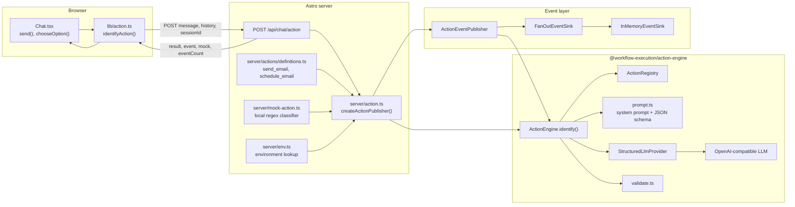
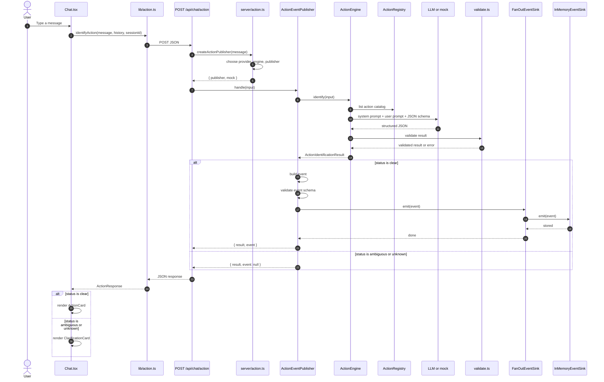
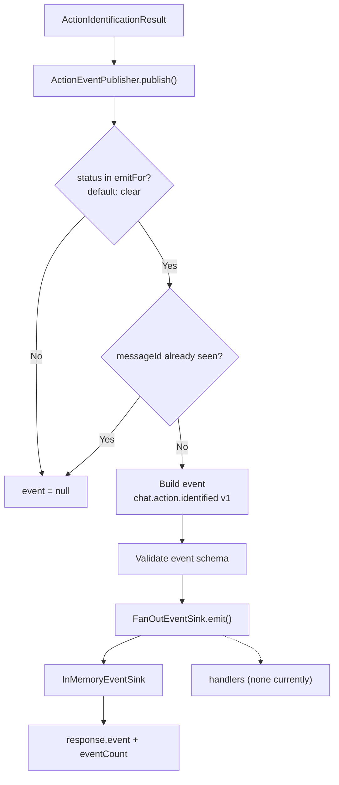
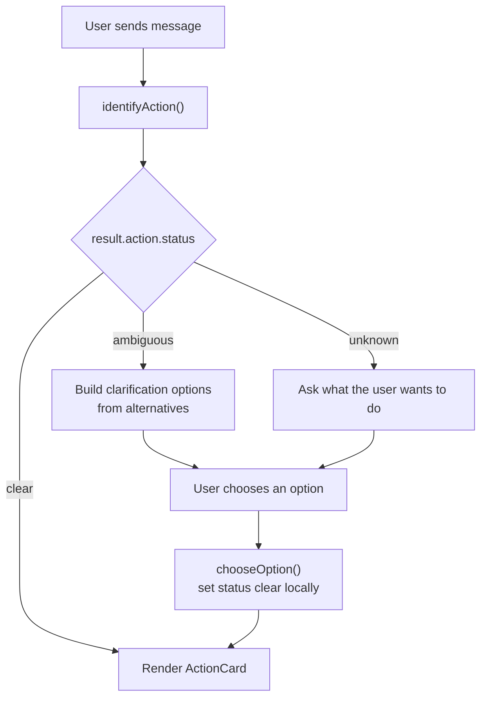

# Action Engine Diagram

For authentication, planned email delivery, scheduling, and the full end-to-end
system, see [SYSTEM_DIAGRAM.md](./SYSTEM_DIAGRAM.md).

This document shows how the current action identification system fits together.
It covers only the implemented flow: chat message -> action identification ->
event storage. Email delivery and the confirmation loop are not implemented yet.

## 1. Component diagram

## 2. Request sequence

## 3. Event pipeline

## 4. UI decision flow

## 5. Current action taxonomy

The app-level catalog lives in
`front-end/src/server/actions/definitions.ts`.

| Action | Purpose | Required parameters |
|---|---|---|
| `send_email` | Send one email immediately | `to`, `subject`, `body` |
| `schedule_email` | Send one email at a future time | `to`, `subject`, `body`, `send_at` |

The catalog is injected into `ActionEngine` by `front-end/src/server/action.ts`.
The action engine has no knowledge of Brevo or email delivery.

## 6. Current boundaries

- The API route only identifies an action. It does not send email.
- Only `clear` results publish `chat.action.identified` events.
- Ambiguous and unknown results return `event: null` and stay in the UI.
- Events are stored in memory and are lost when the server restarts.
- `FanOutEventSink` has no handlers configured, so no follow-up work runs.
- The deleted `/api/chat/action/resolve` endpoint is no longer used.
  `Chat.tsx` resolves a selected clarification option locally.
- Email execution and the confirmation loop still need to be added.
