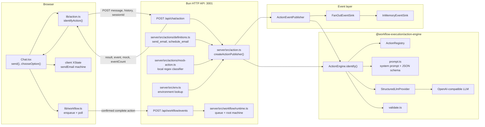
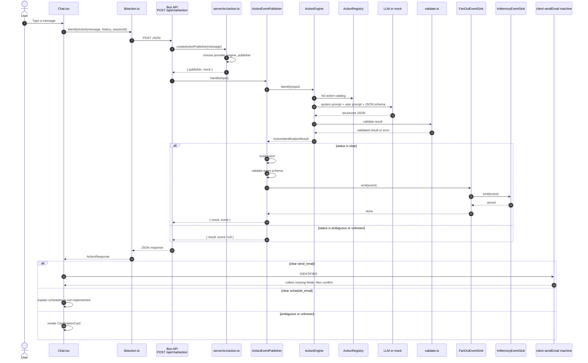
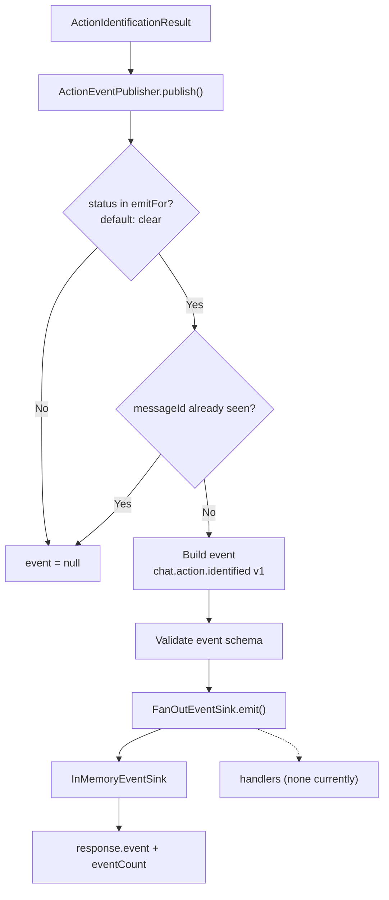
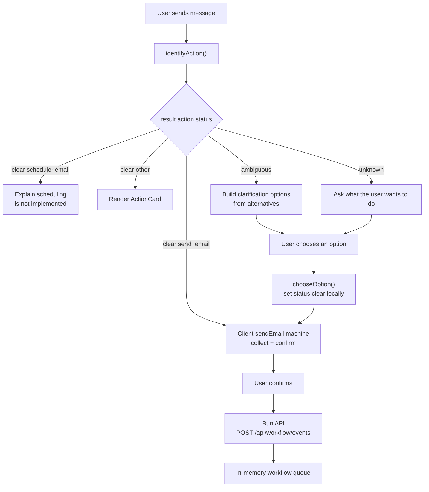
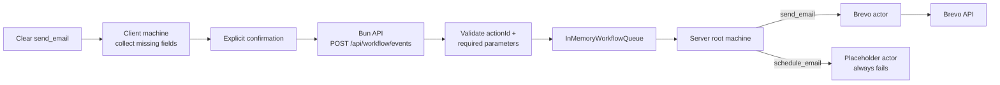

# Action Engine Diagram

For authentication, email delivery, scheduling, and the full end-to-end system,
see [SYSTEM_DIAGRAM.md](./SYSTEM_DIAGRAM.md).

This document focuses on action identification: chat message -> action
identification -> event storage. After identification, Chat collects and
confirms `send_email`, then hands a complete action to the Bun HTTP API workflow
queue. See the system diagram for the queue and root-machine execution flow.

## 1. Component diagram

## 2. Request sequence

## 3. Event pipeline

The identification event is not an execution command. The execution event is
created separately after confirmation.

## 4. UI decision flow

## 5. Current action taxonomy

The app-level catalog lives in `server/src/actions/definitions.ts`.

| Action | Purpose | Required parameters |
|---|---|---|
| `send_email` | Send one email immediately | `to`, `subject`, `body` |
| `schedule_email` | Send one email at a future time | `to`, `subject`, `body`, `send_at` |

The catalog is injected into `ActionEngine` by `server/src/action.ts`. The
action engine has no knowledge of Brevo or email delivery.

## 6. Execution handoff

Only complete, confirmed actions reach the queue. The raw identification event
does not trigger execution.

## 7. Current boundaries

- The action-identification API only identifies an action. It does not send email.
- Only `clear` results publish `chat.action.identified` events.
- Ambiguous and unknown results return `event: null` and stay in the UI.
- Identification events are stored in memory and are lost when the server restarts.
- `FanOutEventSink` has no execution handlers configured.
- The deleted `/api/chat/action/resolve` endpoint is no longer used.
  `Chat.tsx` resolves a selected clarification option locally.
- Confirmed `send_email` actions are queued and executed by the Bun server root
  machine; `schedule_email` is a placeholder.
- Workflow jobs are in-memory and single-process.
- In development, Astro proxies `/api` to the Bun API; production needs a
  reverse proxy.
