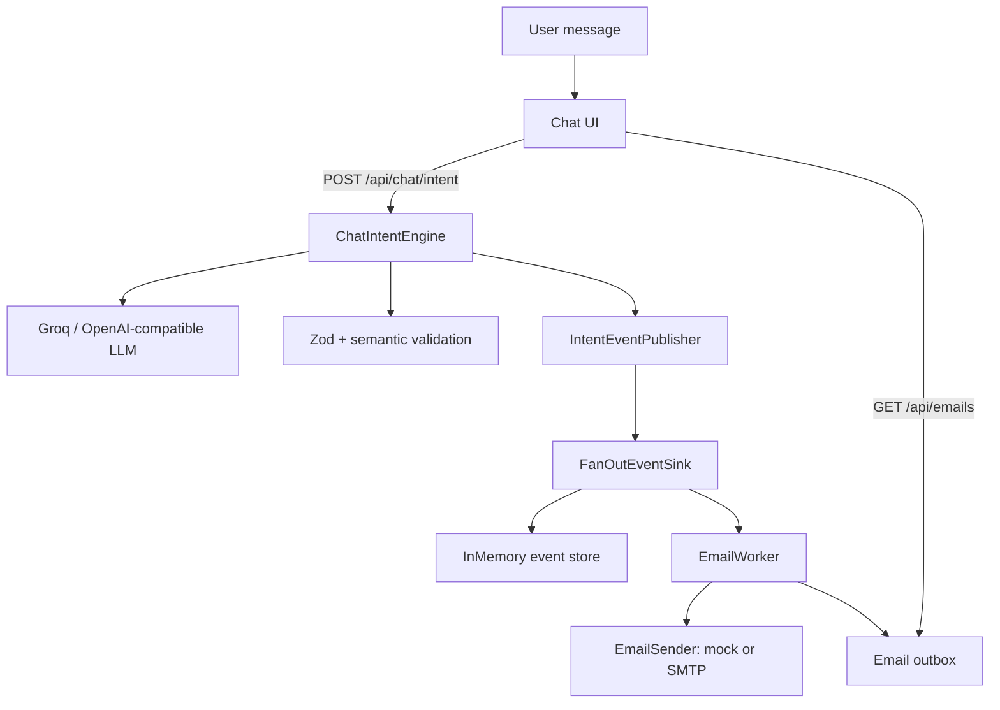
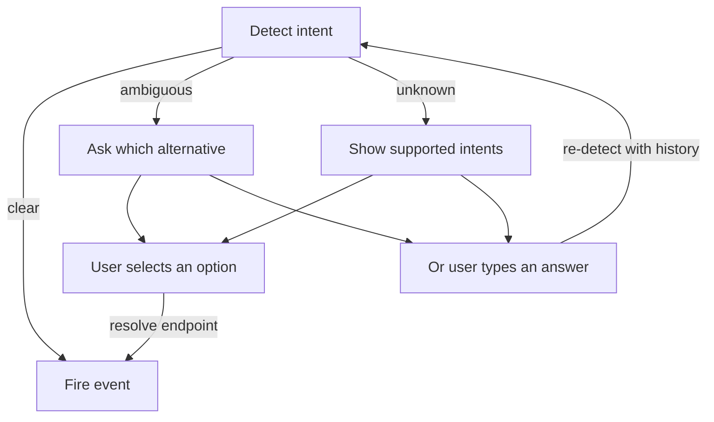

# Architecture

This document describes how the system is structured, how a message becomes an
intent event, and how the email worker consumes that event.

For installation and configuration, see [SETUP.md](./SETUP.md).

---

## 1. Purpose and boundaries

The system has two clear responsibilities:

1. **Interpret** a user message and produce a validated intent result.
2. **Act** on selected intents through an event-driven worker.

The intent engine does **not**:

- send email;
- call SAP or any business API;
- execute workflows;
- ask the user questions;
- invent missing values.

Clarification and side effects live outside the engine.

---

## 2. High-level flow



Only **clear** intents publish events. Ambiguous and unknown results stay in the
UI so they can be clarified first.

---

## 3. Repository layout

```text
.
├── front-end/                    # Astro 5 + React 19 chat app
│   ├── src/
│   │   ├── components/auth/      # demo authentication
│   │   ├── components/chat/      # transcript, clarification, intent cards
│   │   ├── lib/auth.ts           # localStorage demo auth
│   │   ├── lib/intent.ts         # API client + result types
│   │   ├── pages/api/chat/
│   │   │   ├── intent.ts         # detect + publish
│   │   │   └── intent/resolve.ts # resolve a user-selected intent
│   │   ├── pages/api/emails.ts   # inspect the in-memory outbox
│   │   └── server/
│   │       ├── env.ts            # env helper
│   │       ├── intent.ts         # shared publisher + fan-out
│   │       ├── mock-intent.ts    # deterministic local classifier
│   │       ├── email-worker.ts   # event-driven state machine
│   │       └── email-sender.ts   # mock + SMTP senders
│   └── test/                     # Vitest tests
└── packages/chat-intent-engine/  # framework-free intent engine
    ├── src/core/                 # engine, prompt, context, dates, validation
    ├── src/taxonomy/             # closed intent list + registry
    ├── src/events/               # event schema, publisher, sinks
    ├── src/providers/            # OpenAI-compatible provider
    └── test/
```

The engine package has no dependency on Astro, React, or the front-end.

---

## 4. Intent engine

### 4.1 Input

```ts
{
  message: string;
  history?: { role: 'user' | 'assistant'; content: string }[];
  sessionId?: string;
  messageId?: string;
  timestamp?: string;
}
```

`history` is bounded before prompting. `timestamp` is only used to resolve
relative dates such as “next Friday”.

### 4.2 Closed taxonomy

The model may only choose from the registry:

`request`, `send_email`, `question`, `informational`, `meeting`, `follow_up`,
`complaint`, `approval`, `social`, `notification`, `marketing`, `other`.

Each definition contains:

```ts
{
  id: string;
  name: string;
  description: string;
  examples: string[];
  synonyms?: string[];
}
```

Definitions live in `packages/chat-intent-engine/src/taxonomy/definitions.ts`.
The JSON schema sent to the model is generated from the registry ids, so custom
taxonomies are supported.

### 4.3 Result

```ts
{
  intent: {
    primary: string | null;
    status: 'clear' | 'ambiguous' | 'unknown';
    alternatives: string[];
    summary: string;
  };
  entities: { type; text; normalized; evidence }[];
  parameters: { name; value; normalized; evidence }[];
  actionItems: { description; owner; dueDate; evidence }[];
  questions: { question; evidence }[];
  urgency: 'low' | 'normal' | 'high' | 'unknown';
  replyRequired: boolean | null;
  unknowns: string[];
  assumptions: string[];
  ambiguities: string[];
}
```

No numeric confidence score is used.

### 4.4 Pipeline

1. Validate input; reject empty messages.
2. Bound the message and history.
3. Build the prompt from the taxonomy, history, and current message.
4. Call the LLM with a strict JSON schema.
5. Parse with Zod.
6. Verify every intent id exists in the supplied registry.
7. Enforce status consistency:
   - `clear` / `ambiguous` require a primary intent;
   - `unknown` must not have a primary intent;
   - `ambiguous` requires at least one alternative.
8. Verify that every evidence quote appears in the supplied message/history.
9. Normalize explicit/relative dates when justified.
10. Return the typed result or a controlled error.

### 4.5 Provider

`OpenAiCompatibleProvider` uses native `fetch`.

- Works with Groq, OpenAI, and compatible endpoints
- Retries `429` / `5xx` with exponential backoff
- Respects `Retry-After`
- Supports strict and best-effort JSON schema modes
- Keeps temperature at `0`

### 4.6 Errors

All expected failures are typed:

- `EmptyMessageError`
- `InvalidMessageError`
- `LlmProviderError`
- `ChatIntentValidationError`
- `InvalidIntentError`
- `EvidenceMismatchError`

Callers never receive unvalidated model output.

---

## 5. Events

### 5.1 Event schema

Event type: `chat.intent.detected`.

The event contains the intent result, including `parameters`, plus:

```ts
{
  id: string;
  type: 'chat.intent.detected';
  version: 1;
  occurredAt: string;
  sessionId: string;
  messageId?: string;
  source: 'chat';
  // intent, entities, parameters, actionItems, questions,
  // urgency, replyRequired, unknowns, assumptions, ambiguities
}
```

The event does not include the raw user message.

### 5.2 Publisher

`IntentEventPublisher`:

- calls the engine (`handle`) or accepts a resolved result (`publish`);
- emits only configured statuses;
- deduplicates by `messageId`;
- validates the event against its own schema before sending.

The app configures `emitFor: ['clear']`.

### 5.3 Fan-out

`FanOutEventSink` sends each event to:

1. `InMemoryEventSink` — debug endpoint and event count.
2. `EmailWorker` — side effects.

A failing sink or handler is isolated and reported through `onError`.

---

## 6. Chat orchestration

### 6.1 Clarification state machine



- Ambiguous options: `primary + alternatives`.
- Unknown options: full taxonomy.
- Max **2 clarification rounds**.
- Selecting an option calls `/api/chat/intent/resolve` and publishes directly.
- Free-text answers re-run detection with the clarification question in history.
- No event is published for ambiguous, unknown, or unresolved intents.

### 6.2 UI transcript

Each turn is rendered as one of:

- user bubble;
- clarification card with option buttons;
- intent result card;
- error card.

After a `send_email` intent, the UI polls `/api/emails` and appends the send
status to the intent card.

---

## 7. Email automation

### 7.1 Parameters

For `send_email` the model uses:

| Name | Meaning |
|---|---|
| `recipient` | explicit email address |
| `subject` | optional subject |
| `body` | message body |
| `cc` | optional CC addresses |

Missing values go into `unknowns`. The engine never invents them.

### 7.2 Worker state machine

```text
received
  → validating
      → valid      → sending → sent
      → invalid    → needs_info
      → send error → failed
```

Rules:

- recipient must be present and match a basic email pattern;
- body must be non-empty;
- subject is optional;
- CC values are split on `,` / `;` and invalid addresses are dropped;
- duplicate event ids are processed once;
- non-`send_email` events are ignored;
- non-`clear` intents are ignored.

### 7.3 Sender abstraction

`EmailSender` has one method:

```ts
send(message: { to; cc?; subject; body }): Promise<{ id: string }>
```

Implementations:

- `MockEmailSender` — in-memory only, no delivery;
- `SmtpEmailSender` — nodemailer, Gmail defaults.

`createEmailSender()` selects the implementation from `EMAIL_PROVIDER`.

### 7.4 Outbox

`EmailOutbox` keeps per-session records:

- `sent`
- `needs_info` with a reason
- `failed` with a reason

Exposed through `GET /api/emails?sessionId=...`.

---

## 8. API surface

| Method | Path | Purpose |
|---|---|---|
| POST | `/api/chat/intent` | Detect intent, publish if clear |
| POST | `/api/chat/intent/resolve` | Publish a user-selected intent |
| GET | `/api/chat/intent` | Debug: in-memory intent events |
| GET | `/api/emails` | Debug/demo: in-memory email outbox |

There is no generic chat-completion endpoint.

---

## 9. Design decisions

- **Closed taxonomy** keeps output predictable and avoids inventing categories.
- **Engine stays pure**; clarification and side effects are orchestration.
- **Runtime validation** is mandatory because schema-valid output is not
  necessarily semantically correct.
- **Evidence grounding** prevents fabricated quotes.
- **Ambiguity is preserved** instead of forced into a category.
- **Events precede actions**, so other consumers can be added later.
- **Fan-out sink** keeps the in-memory store and workers decoupled.
- **Mock sender** allows local testing without credentials.

---

## 10. Extension points

- Add intent definitions in `taxonomy/definitions.ts`.
- Implement additional `IntentEventSink` targets (webhook, queue, bus).
- Add new event handlers alongside `EmailWorker`.
- Add a contact directory to resolve names to email addresses.
- Add parameter slot-filling for `needs_info` results.

---

## 11. Known limitations

- Events and the outbox are in-memory and reset on restart.
- Auth is a localStorage demo.
- No slot-filling for missing email parameters.
- No contact lookup.
- The engine package exports TypeScript source.
- Auto-send runs on clear intent without confirmation.
- Subject/body extraction depends on phrasing; “saying …” is preferred for the
  body.
