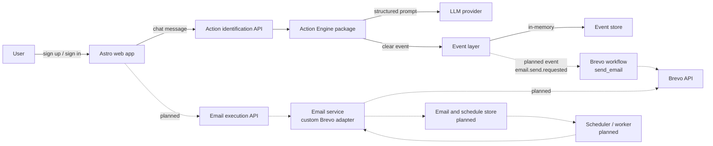
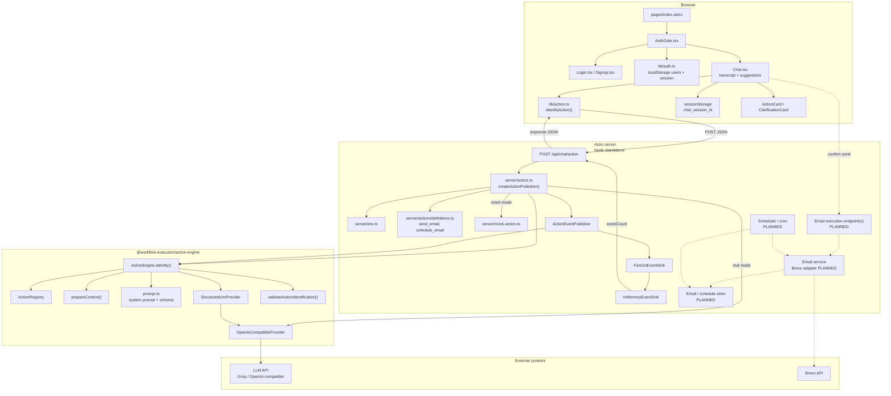
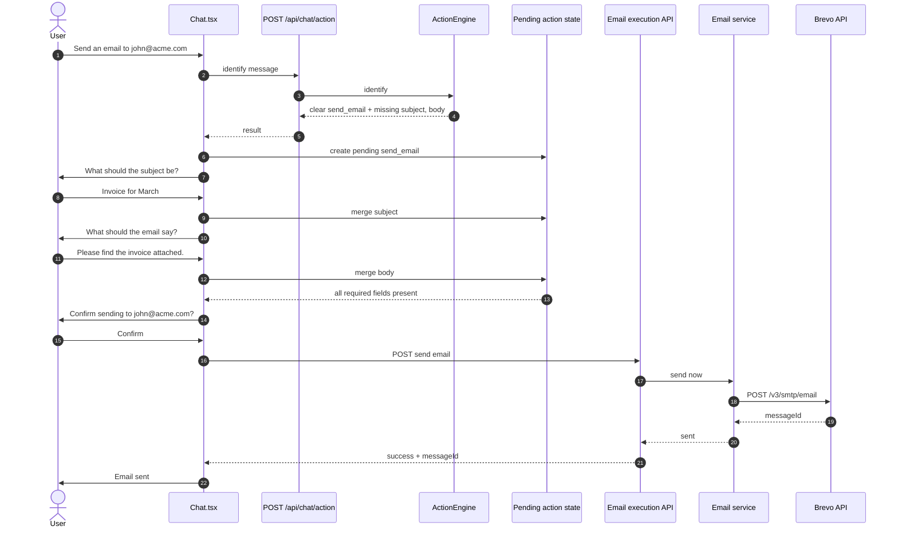
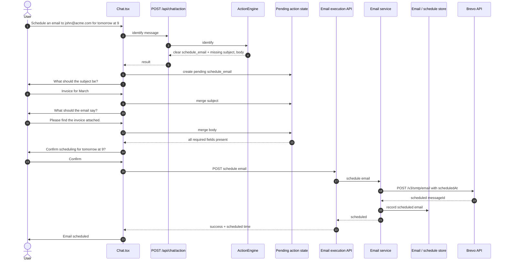
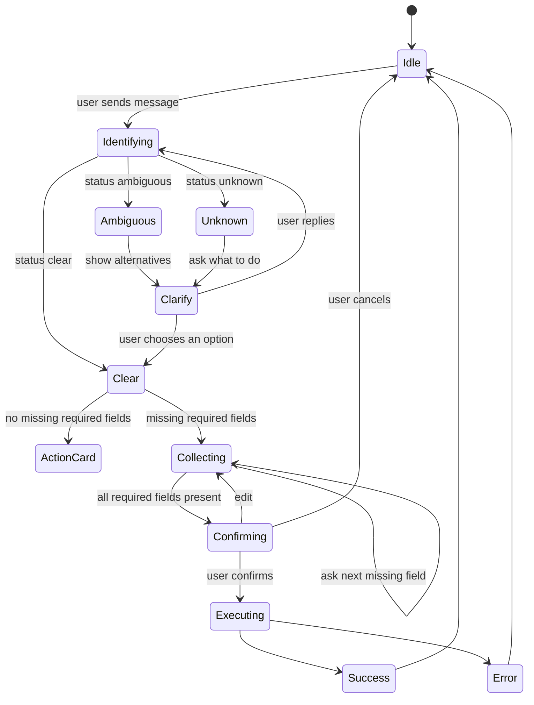
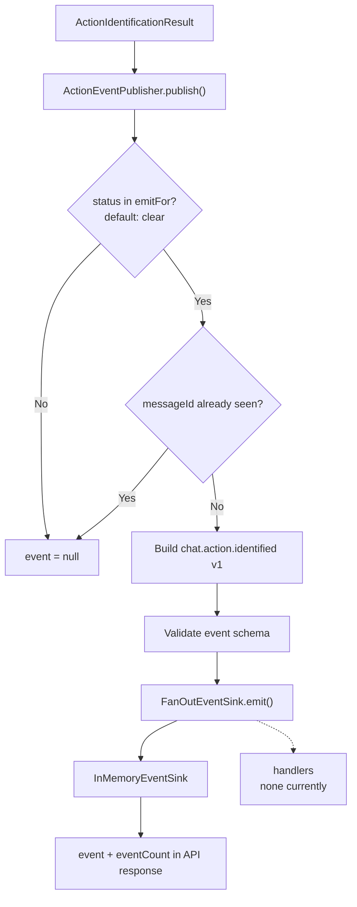
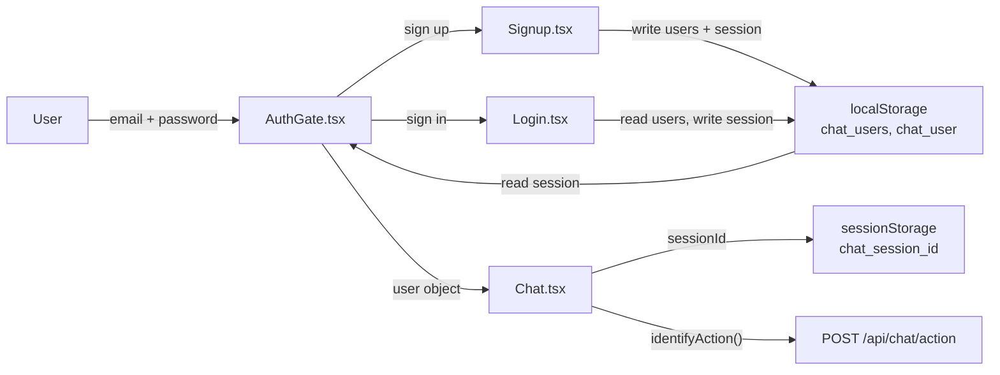
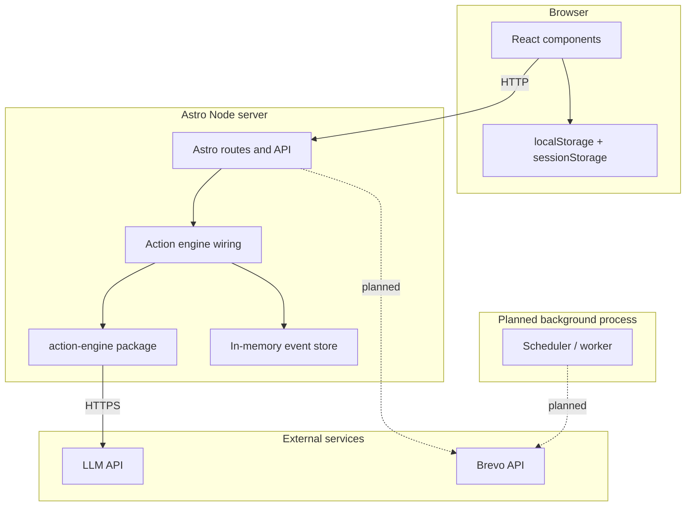

# Entire System Diagram

This document describes the complete system: browser, authentication, chat UI,
Astro server, action engine, events, LLM provider, and the planned email
delivery layer.

## Status legend

| Line style | Meaning |
|---|---|
| Solid | Implemented today |
| Dashed | Planned or not implemented |

Email delivery, scheduling, Brevo integration, parameter collection, and
confirmation are **not implemented** yet. They are shown as planned.

## 1. System context

### Event-to-Brevo workflow mapping (for now)

| Event | Emitted when | Brevo workflow |
|---|---|---|
| `email.send.requested` | User confirms a `send_email` action | `send_email` |

The current implementation emits `chat.action.identified`. The
`email.send.requested` event is the planned execution event, emitted only after
confirmation. `email.schedule.requested` can be added later for
`schedule_email`.

## 2. Component architecture

## 3. Current implemented flow

This is the flow that exists in the repository today.

## 4. Planned send_email flow

`send_email` is currently identified but not executed.

## 5. Planned schedule_email flow

`schedule_email` is currently identified but not executed.

## 6. Clarification and confirmation state machine

Implemented states are solid. Planned states are dashed.

Current implementation stops at `ActionCard` or `Clarify`. `Collecting`,
`Confirming`, `Executing`, and `Success` are planned.

## 7. Event pipeline

## 8. Authentication and session flow

Authentication is client-only and stored in `localStorage`.

Security note: there is no server-side authentication, password hashing, or
session validation. Anyone with browser access can read or modify the stored
user data.

## 9. Runtime topology

## 10. Data stores

| Store | Location | Persistence | Current use |
|---|---|---|---|
| `chat_users` | Browser `localStorage` | Browser-local | Sign-up accounts |
| `chat_user` | Browser `localStorage` | Browser-local | Signed-in user |
| `chat_session_id` | Browser `sessionStorage` | Tab-local | Chat session ID |
| Action events | `InMemoryEventSink` | Process memory | Event count and inspection |
| Pending action | Browser memory | Lost on refresh | Planned state machine |
| Email / schedule records | Not implemented | None | Planned |
| Sequence enrollments | Not implemented | None | Future extension |

## 11. Implementation status

| Area | Status |
|---|---|
| Chat UI and suggestions | Implemented |
| Client-only authentication | Implemented |
| `POST /api/chat/action` | Implemented |
| `send_email` catalog entry | Implemented |
| `schedule_email` catalog entry | Implemented |
| Mock classifier | Implemented |
| LLM provider | Implemented |
| Action validation | Implemented |
| Clarification for ambiguous/unknown | Implemented |
| Event publishing | Implemented |
| In-memory event storage | Implemented |
| Local option resolution | Implemented |
| Missing-parameter collection | Not implemented |
| Explicit confirmation | Not implemented |
| Brevo email sending | Not implemented |
| Scheduled email delivery | Not implemented |
| Email / schedule storage | Not implemented |
| Background scheduler | Not implemented |
| Sequence execution | Not implemented |
| Server-side authentication | Not implemented |

## 12. Endpoint inventory

| Endpoint | Status | Purpose |
|---|---|---|
| `POST /api/chat/action` | Implemented | Identify an action from a chat message |
| `POST /api/chat/action/resolve` | Removed | Previously resolved a selected option |
| `POST /api/email/send` | Planned | Execute `send_email` |
| `POST /api/email/schedule` | Planned | Execute `schedule_email` |
| `GET /api/events` | Not present | Event inspection used to be exposed |

## 13. Related documents

- [ARCHITECTURE.md](./ARCHITECTURE.md)
- [ACTION_ENGINE_DIAGRAM.md](./ACTION_ENGINE_DIAGRAM.md)
- [SETUP.md](./SETUP.md)
