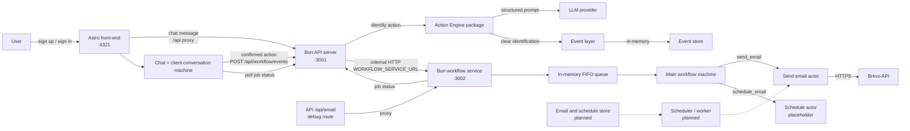
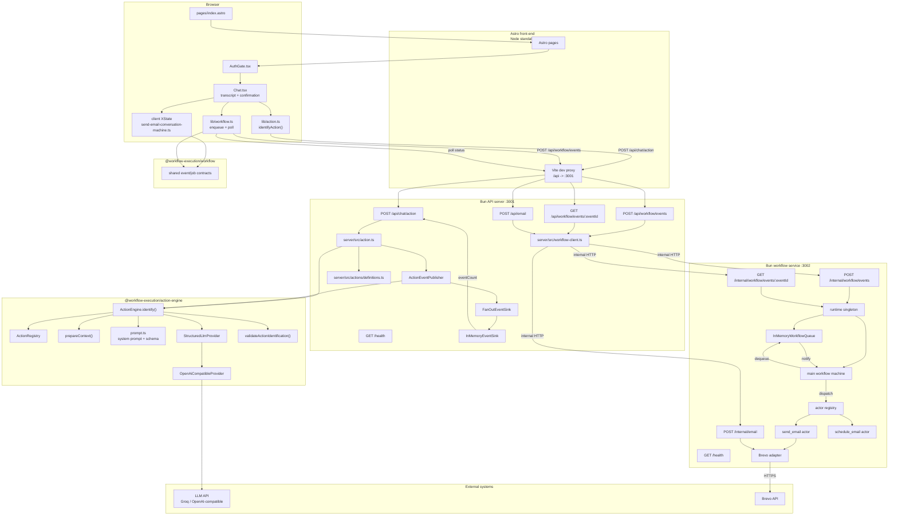
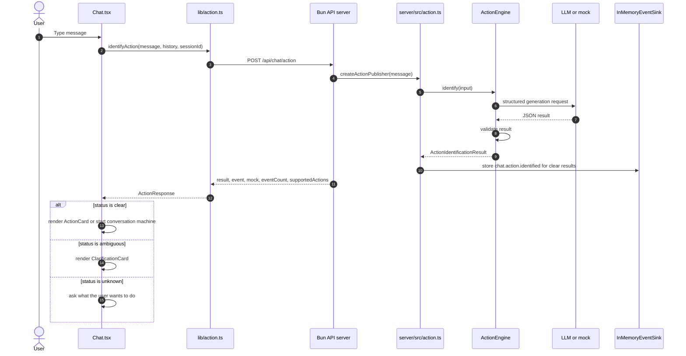
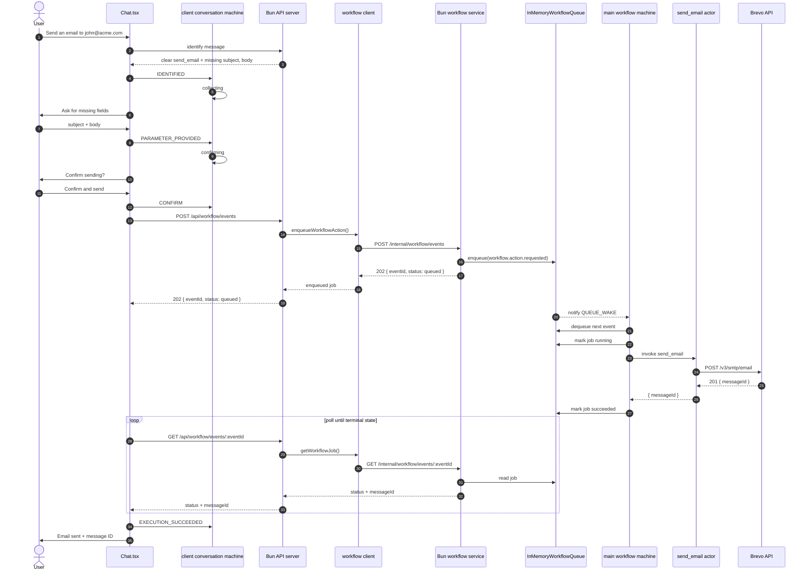
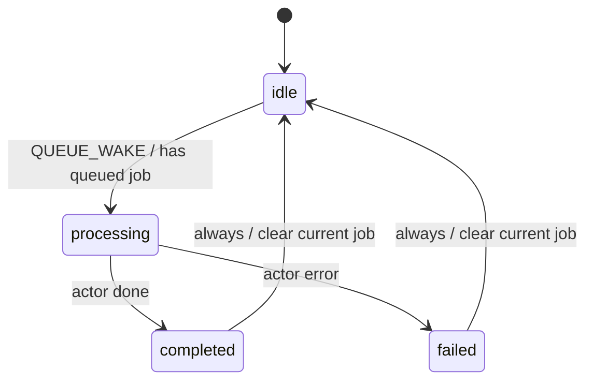
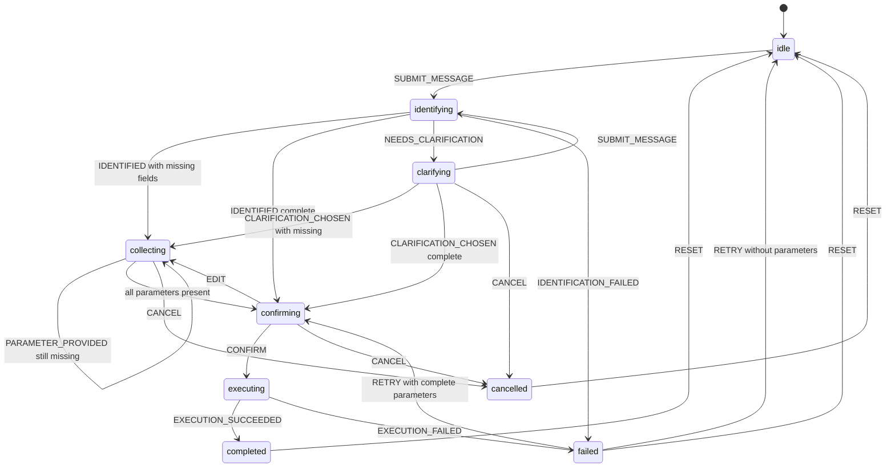
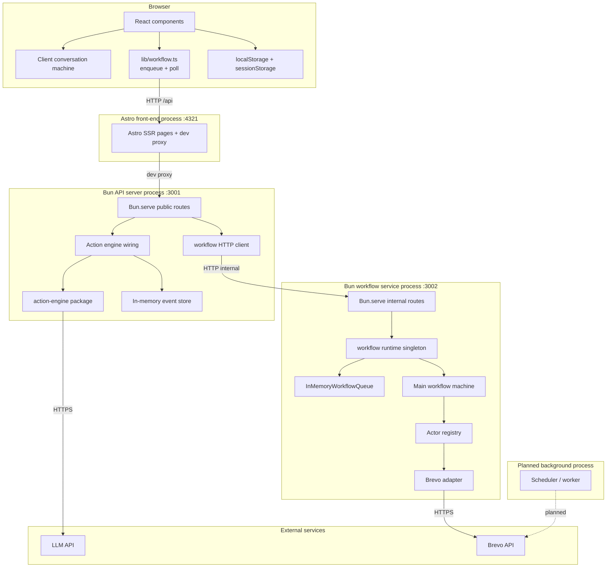

# Entire System Diagram

This document describes the browser, Astro front-end, Bun API server, Bun
workflow service, action engine, events, workflow machines, in-memory queue, and
Brevo transactional email.

## Status legend

| Line style | Meaning |
|---|---|
| Solid | Implemented today |
| Dashed | Planned or not implemented |

Immediate `send_email` delivery is implemented through the public API server,
the standalone workflow service, an in-memory FIFO queue, the main workflow
machine, and a Brevo actor. The chat client keeps the clarification and
confirmation conversation, then enqueues a confirmed action. Scheduling has a
placeholder actor only.

The API server and workflow service are separate Bun processes. The API server
serves public endpoints and proxies workflow requests to the workflow service.
The workflow service owns execution state and is intended for a private network.

## 1. System context

### Event-to-workflow mapping

| Event | Emitted when | Execution |
|---|---|---|
| `chat.action.identified` | An action is identified as `clear` | None; identification only |
| `workflow.action.requested` | User confirms a complete action | Queued in the workflow service |

The raw identification event is not an execution command. Execution requires a
confirmed, complete action.

## 2. Component architecture

## 3. Identification and clarification flow

Clear `send_email` results continue into the client conversation machine.

## 4. send_email flow

If the actor fails, the main machine records `status: failed` and the error.
Chat sends `EXECUTION_FAILED` to the client machine.

## 5. Main workflow machine

The main machine lives in `workflow/src/server/main-machine.ts` inside the
workflow service.

The queue listener wakes the machine whenever a job is enqueued. The machine
processes one job at a time, looks up the actor by `event.actionId`, and raises
another wake-up after completion.

## 6. Client conversation machine

The client machine lives in
`front-end/src/lib/chat/send-email-conversation-machine.ts`.

The machine is pure and framework-free. `Chat.tsx` performs identification,
enqueueing, and polling.

## 7. Runtime topology

## 8. Data stores

| Store | Location | Persistence | Current use |
|---|---|---|---|
| `chat_users` | Browser `localStorage` | Browser-local | Sign-up accounts |
| `chat_user` | Browser `localStorage` | Browser-local | Signed-in user |
| `chat_session_id` | Browser `sessionStorage` | Tab-local | Chat session ID |
| Action events | `InMemoryEventSink` in the API server | Process memory | Event count and inspection |
| Pending action | Browser memory (client XState) | Lost on refresh | `send_email` conversation |
| Workflow jobs | `InMemoryWorkflowQueue` in the workflow service | Process memory | Queue, status, result, errors |
| Email / schedule records | Not implemented | None | Brevo message ID is returned but not stored |
| Sequence enrollments | Not implemented | None | Future extension |

## 9. Implementation status

| Area | Status |
|---|---|
| Chat UI and suggestions | Implemented |
| Client-only authentication | Implemented |
| Client conversation machine in front-end | Implemented |
| Bun API server and public routes | Implemented |
| Bun workflow service and internal routes | Implemented |
| API-to-workflow HTTP proxy | Implemented |
| `POST /api/chat/action` | Implemented |
| `send_email` catalog entry | Implemented |
| `schedule_email` catalog entry | Implemented |
| Mock classifier | Implemented |
| LLM provider | Implemented |
| Action validation | Implemented |
| Clarification for ambiguous/unknown | Implemented |
| Event publishing | Implemented |
| In-memory event storage | Implemented |
| Client XState `send_email` conversation | Implemented |
| Missing-parameter collection | Implemented in the client machine |
| Explicit confirmation | Implemented in the client machine |
| `POST /api/workflow/events` | Implemented |
| `GET /api/workflow/events/:eventId` | Implemented |
| In-memory workflow queue | Implemented in the workflow service |
| Main workflow machine | Implemented |
| `send_email` actor and Brevo sending | Implemented |
| `schedule_email` actor | Placeholder; always fails |
| Execution event (`workflow.action.requested`) | Implemented |
| Job status polling in Chat | Implemented |
| Direct `/api/email` debug route | Implemented; proxied |
| Persistent workflow jobs | Not implemented |
| Retry / cancellation | Not implemented |
| Scheduled email delivery | Not implemented |
| Email / schedule storage | Not implemented |
| Background scheduler | Not implemented |
| Server-side authentication | Not implemented |

## 10. Endpoint inventory

Public API server, default `127.0.0.1:3001`:

| Endpoint | Status | Purpose |
|---|---|---|
| `GET /health` | Implemented | API server health |
| `POST /api/chat/action` | Implemented | Identify an action |
| `POST /api/workflow/events` | Implemented | Validate and proxy enqueue |
| `GET /api/workflow/events/:eventId` | Implemented | Proxy job status |
| `POST /api/email` | Implemented | Proxy direct debug send |

Internal workflow service, default `127.0.0.1:3002`:

| Endpoint | Status | Purpose |
|---|---|---|
| `GET /health` | Implemented | Workflow service health |
| `POST /internal/workflow/events` | Implemented | Enqueue a confirmed action |
| `GET /internal/workflow/events/:eventId` | Implemented | Read job status |
| `POST /internal/email` | Implemented | Direct debug send |

## 11. Related documents

- [ARCHITECTURE.md](./ARCHITECTURE.md)
- [ACTION_ENGINE_DIAGRAM.md](./ACTION_ENGINE_DIAGRAM.md)
- [SETUP.md](./SETUP.md)
