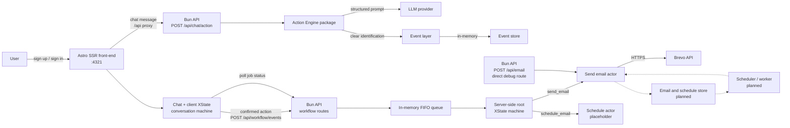
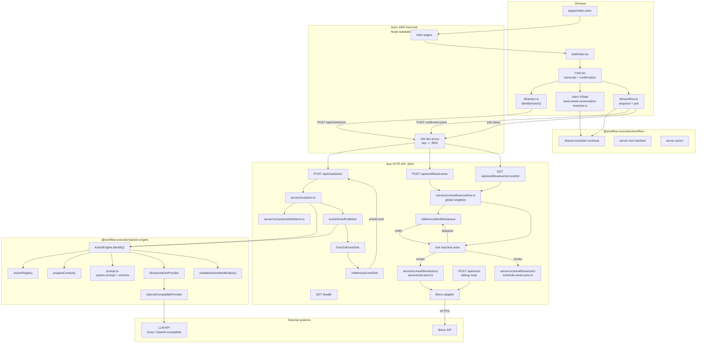
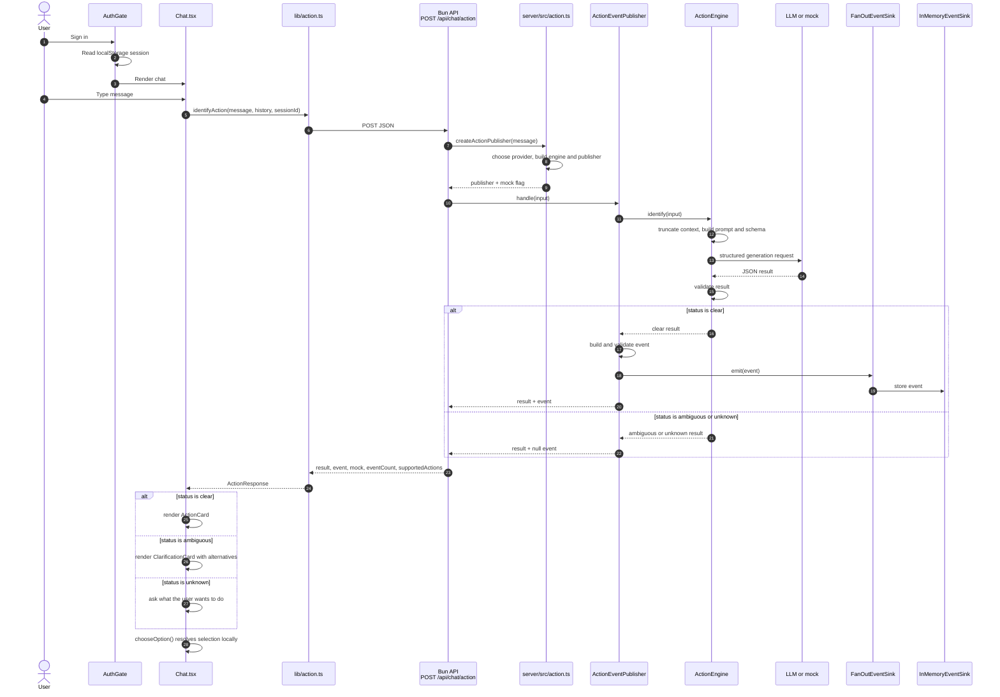
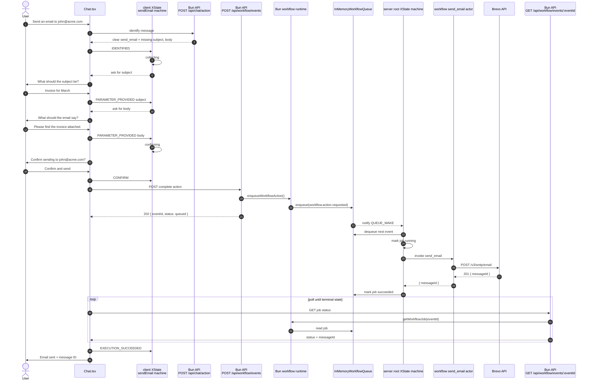
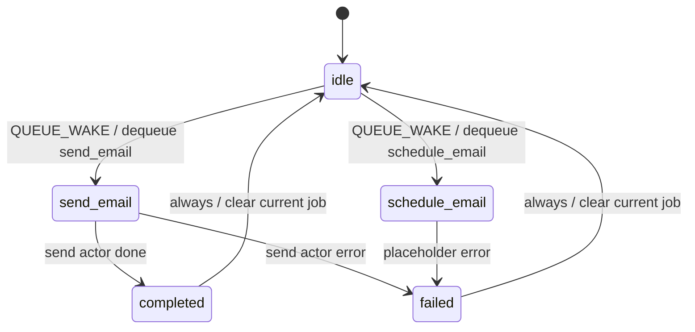
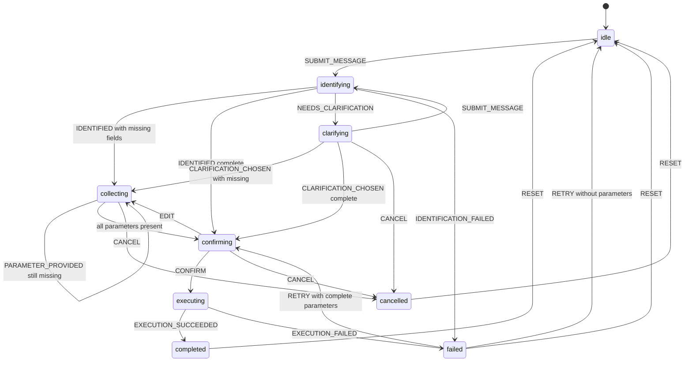
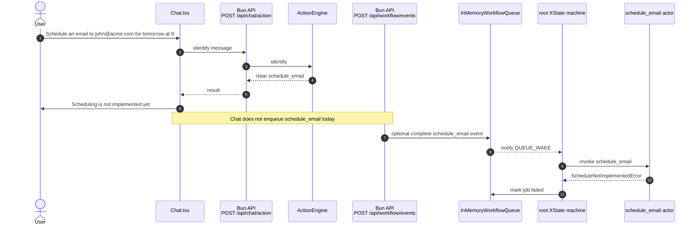
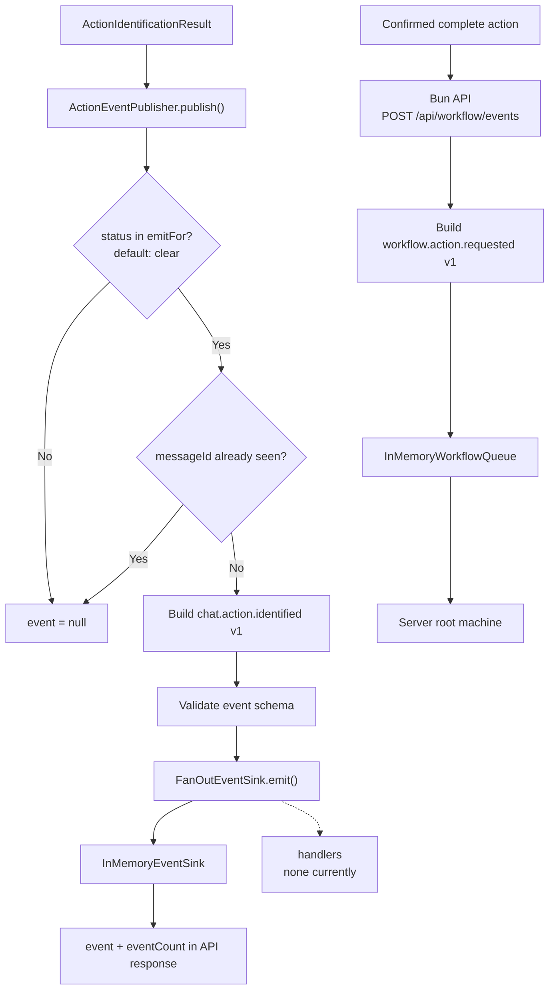
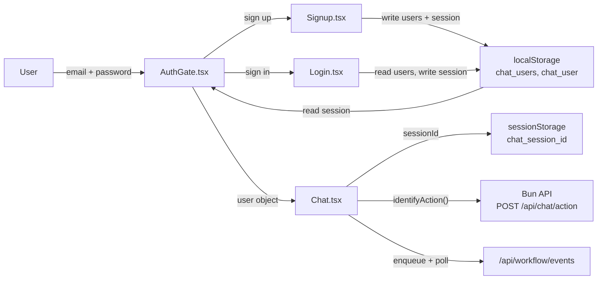

# Entire System Diagram

This document describes the complete system: browser, authentication, chat UI,
the Astro SSR front-end, the Bun HTTP API, the action engine, events, LLM
provider, XState workflow machines, the in-memory execution queue, and Brevo
transactional email.

## Status legend

| Line style | Meaning |
|---|---|
| Solid | Implemented today |
| Dashed | Planned or not implemented |

Immediate `send_email` delivery is implemented through a Bun HTTP API, a
server-side XState root machine, an in-memory FIFO queue, and a Brevo actor. The
chat client keeps the clarification and confirmation conversation, then enqueues
a confirmed action. Scheduling has a placeholder root-machine state only.
Persistent records, retries, background workers, and server-side authentication
remain planned.

In development, the Astro front-end proxies relative `/api` requests to the Bun
API. The Astro production server does not include that proxy automatically;
production needs a reverse proxy or equivalent same-origin routing.

## 1. System context

### Event-to-Brevo workflow mapping

| Event | Emitted when | Execution |
|---|---|---|
| `chat.action.identified` | An action is identified as `clear` | None; identification only |
| `workflow.action.requested` | User confirms a complete action | Queued for the server root machine |

The raw identification event is not an execution command. Execution requires a
confirmed, complete action. `schedule_email` events are accepted by the queue but
fail in the placeholder actor.

## 2. Component architecture

## 3. Identification and clarification flow

Clear `send_email` results continue into the client conversation machine in
section 4. Clear `schedule_email` results stop at the action card.

## 4. send_email flow (implemented)

`Chat.tsx` owns the client conversation state and the enqueue/poll effects. The
server root machine owns execution after the confirmed event is queued.

If the actor fails, the root machine records `status: failed` and the error. Chat
sends `EXECUTION_FAILED` to the client machine.

## 5. Server root workflow machine (implemented)

The root machine lives in `workflow/src/server/root-machine.ts`. It is started
only by `server/src/runtime.ts` inside the Bun API process.

The queue listener wakes the machine whenever a job is enqueued. The machine
processes one job at a time and raises another wake-up after completion.

## 6. Client send-email conversation machine (implemented)

The client conversation machine lives in
`front-end/src/lib/chat/send-email-conversation-machine.ts`. `Chat.tsx` sends events into it
and performs the enqueue/poll effects after `CONFIRM`.

The machine is pure and framework-free. The React layer calls the workflow API;
the client machine does not perform I/O.

## 7. schedule_email placeholder flow

`schedule_email` is identified by the catalog, but Chat does not collect or
confirm it. The workflow API accepts a complete event for exercising the root
machine, where the placeholder actor fails the job.

There is no schedule store, worker, or real scheduled delivery yet.

## 8. Event pipeline

Identification events and execution events are separate.

## 9. Authentication and session flow

Authentication is client-only and stored in `localStorage`.

Security note: there is no server-side authentication, password hashing, or
session validation. Anyone with browser access can read or modify the stored
user data.

## 10. Runtime topology

```mermaid
flowchart TB
  subgraph BrowserProcess["Browser"]
    React["React components"]
    ClientMachine["Client XState<br/>conversation machine"]
    ClientWorkflow["lib/workflow.ts<br/>enqueue + poll"]
    LocalData["localStorage + sessionStorage"]
  end

  subgraph AstroProcess["Astro front-end process :4321"]
    AstroRoutes["Astro SSR pages + dev proxy"]
  end

  subgraph BunProcess["Bun API process :3001"]
    ApiRoutes["Bun.serve routes"]
    ActionWiring["Action engine wiring"]
    ActionPackage["action-engine package"]
    Runtime["workflow runtime singleton"]
    Queue["InMemoryWorkflowQueue"]
    RootMachine["Server root XState machine"]
    BrevoAdapter["Brevo adapter"]
    MemoryEvents["In-memory event store"]
  end

  subgraph PlannedProcess["Planned background process"]
    Scheduler["Scheduler / worker"]
  end

  subgraph ExternalServices["External services"]
    LLM["LLM API"]
    Brevo["Brevo API"]
  end

  React --> LocalData
  React --> ClientMachine
  React --> ClientWorkflow
  ClientWorkflow -->|"HTTP /api"| AstroRoutes
  AstroRoutes -->|"dev proxy"| ApiRoutes
  ApiRoutes --> ActionWiring
  ActionWiring --> ActionPackage
  ActionPackage -->|"HTTPS"| LLM
  ActionWiring --> MemoryEvents
  ApiRoutes --> Runtime
  Runtime --> Queue
  Runtime --> RootMachine
  RootMachine -->|"actor"| BrevoAdapter
  BrevoAdapter -->|"HTTPS"| Brevo
  Scheduler -.->|"planned"| Brevo
```

## 11. Data stores

| Store | Location | Persistence | Current use |
|---|---|---|---|
| `chat_users` | Browser `localStorage` | Browser-local | Sign-up accounts |
| `chat_user` | Browser `localStorage` | Browser-local | Signed-in user |
| `chat_session_id` | Browser `sessionStorage` | Tab-local | Chat session ID |
| Action events | `InMemoryEventSink` in the Bun process | Process memory | Event count and inspection |
| Pending action | Browser memory (client XState) | Lost on refresh | Implemented `send_email` conversation |
| Workflow jobs | `InMemoryWorkflowQueue` in the Bun process | Process memory | Queue, status, result, errors |
| Email / schedule records | Not implemented | None | Brevo message ID is returned but not stored |
| Sequence enrollments | Not implemented | None | Future extension; Brevo has no public sequence API |

## 12. Implementation status

| Area | Status |
|---|---|
| Chat UI and suggestions | Implemented |
| Client-only authentication | Implemented |
| Bun HTTP server and route table | Implemented |
| Vite `/api` development proxy | Implemented |
| `POST /api/chat/action` | Implemented (Bun API) |
| `send_email` catalog entry | Implemented |
| `schedule_email` catalog entry | Implemented |
| Mock classifier | Implemented |
| LLM provider | Implemented |
| Action validation | Implemented |
| Clarification for ambiguous/unknown | Implemented |
| Event publishing | Implemented |
| In-memory event storage | Implemented |
| Local option resolution | Implemented |
| Client XState `send_email` conversation | Implemented |
| Missing-parameter collection | Implemented in the client machine |
| Explicit confirmation | Implemented in the client machine |
| `POST /api/workflow/events` | Implemented (Bun API) |
| `GET /api/workflow/events/:eventId` | Implemented (Bun API) |
| `GET /health` | Implemented (Bun API) |
| In-memory workflow queue | Implemented |
| Server-side root XState machine | Implemented |
| `send_email` actor and Brevo sending | Implemented |
| `schedule_email` root state | Placeholder; always fails |
| Execution event (`workflow.action.requested`) | Implemented |
| Job status polling in Chat | Implemented |
| Direct `POST /api/email` debug route | Implemented (Bun API) |
| Persistent workflow jobs | Not implemented |
| Retry / cancellation | Not implemented |
| Scheduled email delivery | Not implemented |
| Email / schedule storage | Not implemented |
| Background scheduler | Not implemented |
| Sequence execution | Not implemented |
| Server-side authentication | Not implemented |

## 13. Endpoint inventory

All endpoints are served by the Bun API on `HOST:PORT` (default
`127.0.0.1:3001`). In development, Astro proxies `/api` to it.

| Endpoint | Status | Purpose |
|---|---|---|
| `GET /health` | Implemented | Bun API health check |
| `POST /api/chat/action` | Implemented | Identify an action from a chat message |
| `POST /api/chat/action/resolve` | Removed | Previously resolved a selected option |
| `POST /api/workflow/events` | Implemented | Validate and enqueue a confirmed action |
| `GET /api/workflow/events/:eventId` | Implemented | Read workflow job status and result |
| `POST /api/email` | Implemented | Direct debug send through Brevo, bypassing the queue |
| `POST /api/email/schedule` | Planned | Real scheduled delivery |
| `GET /api/events` | Not present | Event inspection used to be exposed |

## 14. Related documents

- [ARCHITECTURE.md](./ARCHITECTURE.md)
- [ACTION_ENGINE_DIAGRAM.md](./ACTION_ENGINE_DIAGRAM.md)
- [SETUP.md](./SETUP.md)
